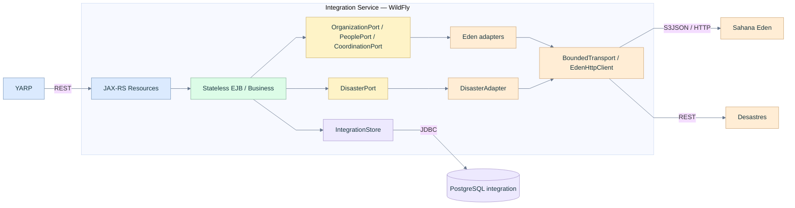
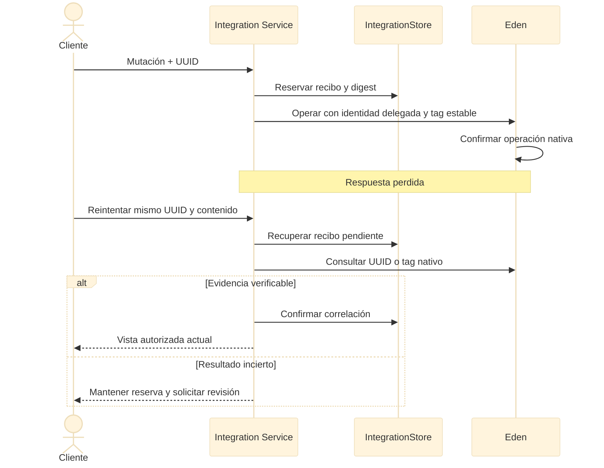
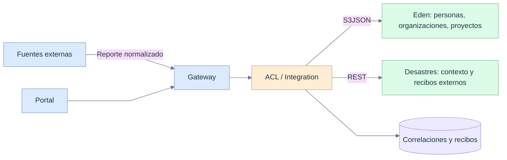

<div align="center">

# RECONECTA

### Integration Service

**De la emergencia a la reconstrucción**

Capa anticorrupción y adaptación de sistemas externos.


**Pontificia Universidad Javeriana**

Arquitectura de Software · 2026

[Plataforma completa](https://github.com/disaster-management-platform/disaster-platform-infrastructure) · [Arquitectura](#arquitectura) · [Demostración](#demostración) · [Instalación](#instalación-y-ejecución)

</div>

---

## Demostración

<div align="center">

[](https://youtu.be/HVCKoTRAxu8)

[Ver demostración funcional de RECONECTA](https://youtu.be/HVCKoTRAxu8)

</div>

## Descripción

`disaster-integration-service` implementa la frontera semántica entre RECONECTA, Sahana Eden y el servicio propietario de Desastres. Utiliza puertos y adaptadores como Anti-Corruption Layer (ACL): transforma contratos sin duplicar la lógica de los sistemas nativos. También expone un ingreso de reportes normalizados para fuentes externas autenticadas.

## Contenido

- [Funcionalidades](#funcionalidades)
- [Arquitectura](#arquitectura)
- [Decisiones arquitectónicas](#decisiones-arquitectónicas)
- [Tecnologías y justificación](#tecnologías-y-justificación)
- [Estructura del repositorio](#estructura-del-repositorio)
- [Integración con otros componentes](#integración-con-otros-componentes)
- [Persistencia](#persistencia)
- [Contratos de comunicación](#contratos-de-comunicación)
- [Seguridad](#seguridad)
- [Instalación y ejecución](#instalación-y-ejecución)
- [Pruebas](#pruebas)
- [Alcance y validación](#alcance-y-validación)
- [Repositorios relacionados](#repositorios-relacionados)
- [Autores](#autores)

## Funcionalidades

| Funcionalidad | Descripción |
| --- | --- |
| Organizaciones | Directorio, tipos, alta y actualización con identidad técnica delegada. |
| Personas | Consulta, registro, actualización y asociación verificada con desastre. |
| Coordinación | Tareas y actividades en proyectos y eventos nativos autorizados. |
| Reportes externos | Ingreso normalizado monitoring, gis, hospital, administrative y financial. |
| Reconciliación | Recibos, UUID y etiquetas nativas para recuperar respuestas perdidas. |
| Referencias nativas | Enlaces opcionales a familias, expedientes, refugios y logística sin duplicar sus reglas. |

## Arquitectura

### Vista lógica — Anti-Corruption Layer




### Responsabilidades de los componentes

| Componente | Responsabilidad |
| --- | --- |
| Resources | Contratos REST, filtrado y resolución de identidad. |
| OrganizationService / PeopleService / CoordinationService | Orquestación y validación de contexto. |
| ExternalReportService | Normaliza identidad de fuente y delega el recibo a Desastres. |
| OrganizationPort / PeoplePort / CoordinationPort / DisasterPort | Abstraen los contratos externos. |
| Eden adapters / DisasterAdapter | Traducción de formatos e identificadores. |
| IntegrationStore | Recibos y correlaciones locales. |
| BoundedTransport / IntegrationBudget | Control de tiempo, tamaño y concurrencia. |

### Vista de procesos

Un WAR sobre WildFly administra EJB, JPA/JTA y CDI. Los puertos se resuelven hacia adaptadores HTTP. Eden ejecuta su propio proceso Python/web2py; Desastres ejecuta ASP.NET Core. El acceso remoto se realiza sin mantener abierta una transacción JTA.

### Recuperación de una respuesta perdida


No se reenvía automáticamente una mutación nativa cuyo resultado es incierto. Los recibos no conservan copias de datos personales.

## Decisiones arquitectónicas

| Atributo de calidad | Decisión | Mecanismo y compromiso |
| --- | --- | --- |
| Interoperabilidad | ACL / contratos canónicos | Traduce S3JSON a REST sin incorporar reglas nativas al dominio Java. |
| Resiliencia | Bulkheads y budgets | 8 llamadas a Eden y 4 a Desastres por réplica; límite conjunto de 20 s. |
| Integridad | Recibos y reconciliación | UUID, digest y tag nativo conservan identidad; incertidumbre exige revisión. |
| Modificabilidad | Puertos/adaptadores | Aísla particularidades del proveedor; cambios semánticos requieren validación. |
| Seguridad | Delegaciones | Separa identidades técnicas por organización y alcance. |
| Rendimiento | Consultas agrupadas | Evita N+1 innecesario; búsquedas siguen acotadas a roster autorizado. |

## Tecnologías y justificación

| Tecnología | Justificación para la integración |
| --- | --- |
| Java 21 / Jakarta EE 11 y WildFly 42 | Permiten alojar servicios REST y transacciones locales bajo el mismo modelo de ejecución que Daños. |
| JAX-RS / JSON | Contrato estable consumible por ASP.NET y clientes móviles independientemente del formato nativo. |
| S3JSON | Reutiliza las APIs de importación/exportación de Eden y sus ACL; no interpreta tablas directamente. |
| EJB / CDI | Separa orquestación, puertos y dependencias; el contenedor administra concurrencia. |
| JPA / PostgreSQL JDBC | Conserva correlaciones y recibos sin replicar información personal de Eden. |
| MicroProfile JWT / OAuth 2.0 | Integra identidad común y credenciales de servicio con Desastres. |
| Docker / Maven | Empaqueta el WAR y dependencias como unidad independiente. |

## Estructura del repositorio

```text
disaster-integration-service/
├── src/main/java/platform/integration/
│   ├── api/
│   ├── business/
│   ├── domain/
│   ├── integration/
│   │   ├── disasters/
│   │   ├── eden/
│   │   └── http/
│   └── persistence/
├── src/main/resources/META-INF/openapi.json
├── migrations/                   # V001 a V004
├── server/                       # datasource.cli, permissions.sql
├── scripts/
├── tests/
├── pom.xml
└── Dockerfile
```

## Integración con otros componentes

### Propiedad de la información


El directorio de organizaciones no confiere permiso de consulta de personas. La correlación usa ID y UUID nativos, organización y desastre; la coincidencia de IDs numéricos no demuestra identidad. La coordinación requiere EVENT/PROJECT vinculado y proyecto de la organización. SUPPLY, INV, REQ, DVR y CR permanecen nativos. Las fuentes externas envían `sourceReportId` estable y `content` hasta 64 KiB; solo monitoring puede solicitar creación preliminar. No hay conectores verificados FHIR, GIS o financieros de proveedores específicos; el ingreso normalizado no ejecuta pagos.

## Persistencia

El esquema `integration` contiene únicamente recibos, enlaces y correlaciones. V001–V004 son migraciones explícitas. V002 y V003 rechazan correlaciones históricas cuya identidad no se pueda demostrar; V004 incorpora recibos de coordinación. No se copian tablas de Eden ni se accede a `disasters` directamente. Las operaciones inciertas reservan el recurso nativo hasta reconciliarlo. El transporte limita respuestas a 4 MiB, conexión a 5 s y llamada a 10 s, dentro de un presupuesto compartido de 20 s; no sigue redirecciones.

## Contratos de comunicación

| Método | Ruta | Responsabilidad |
| --- | --- | --- |
| GET / POST | `/api/organizaciones` | Directorio / crear. |
| GET / PUT | `/api/organizaciones/{id}` | Detalle / actualizar. |
| GET | `/api/organizaciones/tipos` | Catálogo. |
| GET / POST | `/api/personas-afectadas` | Listar / crear. |
| GET / PUT | `/api/personas-afectadas/{id}` | Detalle / editar. |
| GET | `/api/personas-afectadas/resumen` | Agregados del roster autorizado. |
| POST | `/api/personas-afectadas/{id}/vincular` | Correlación verificada. |
| GET / POST | `/api/coordinacion/tareas` y `/api/coordinacion/actividades` | Consultar / crear. |
| PUT | `/api/coordinacion/tareas/{id}` y `/api/coordinacion/actividades/{id}` | Editar. |
| POST | `/api/integracion/reportes/{category}` | Recepción normalizada. |
| GET | `/api/integracion/diagnostico/live` y `/api/integracion/diagnostico/ready` | Diagnóstico interno. |
OpenAPI se encuentra en `src/main/resources/META-INF/openapi.json`. Las mutaciones de personas y coordinación requieren UUID `Idempotency-Key`. Las asociaciones se validan contra el propietario; el actor de una fuente se deriva del token, nunca del cuerpo.

## Seguridad

JWT validado por MicroProfile, audiencia `integration-service`. Roles `org.read`, `org.admin`, `org.create`, `people.read/write`, `coordination.read/write` e `integration.{category}`. Para personas se requiere delegación organizacional y para operaciones por desastre también ámbito verificable. Las credenciales nativas de Eden son distintas por organización y responsabilidad; no se propaga el JWT al sistema nativo como contraseña. Las identidades de lectura y recepción de Desastres son independientes mediante Client Credentials. Los permisos nativos de Eden siguen siendo obligatorios.

## Instalación y ejecución

Para ejecutar la plataforma completa, consultar [Infrastructure](https://github.com/disaster-management-platform/disaster-platform-infrastructure).

```bash
git clone https://github.com/disaster-management-platform/disaster-integration-service.git
cd disaster-integration-service
```
Requiere Java 21, Maven, WildFly 42, PostgreSQL y Eden configurado; opción Docker:

```bash
mvn clean package
docker build -t disaster-integration-service:local .
```

El WAR `target/integration-service.war` se despliega en contexto raíz independiente. Configurar JNDI `java:jboss/datasources/Integration` mediante `server/datasource.cli`. Aplicar V001–V004 faltantes y `server/permissions.sql` antes de arrancar; no migra automáticamente.

| Configuración | Propósito |
|---|---|
| `JWT_ISSUER`, `JWT_AUDIENCE`, `JWT_PUBLIC_KEY_LOCATION` | Identidad y JWKS. |
| `EDEN_BASE_URL`, `EDEN_TECH_USER`, `EDEN_TECH_PASSWORD` | Directorio nativo. |
| `EDEN_DELEGATIONS_FILE`, `EDEN_PUBLIC_BASE_URL` | Delegaciones privadas y enlace nativo. |
| `EDEN_ORG_CREATE_USER`, `EDEN_ORG_CREATE_PASSWORD` | Identidad separada de creación de organizaciones. |
| `DISASTERS_BASE_URL` | Propietario REST de Desastres. |
| `DISASTERS_READ_OAUTH_*`, `DISASTERS_REPORT_OAUTH_*` | TokenEndpoint, ClientId y ClientSecret mediante los nombres completos `TOKEN_ENDPOINT`, `CLIENT_ID`, `CLIENT_SECRET`. |
| `INTEGRATION_DB_HOST`, `INTEGRATION_DB_PORT`, `INTEGRATION_DB_NAME`, `INTEGRATION_DB_CA`, `INTEGRATION_DB_USER`, `INTEGRATION_DB_PASSWORD` | DataSource PostgreSQL. |

Secretos fuera de Git, CA confiables y delegaciones con permisos mínimos. El contenedor usa puerto 8080; no exponer administración.

## Pruebas

```bash
./scripts/test_local.sh
mvn clean package
```

Con entorno aislado, `INTEGRATION_TEST_URL`, `INTEGRATION_TEST_PRIVATE_KEY`, `JWT_ISSUER` y `JWT_AUDIENCE` configurados, utilizar `requests` y `PyJWT`:

```bash
python3 scripts/test_integration.py --targeted
python3 scripts/people_test.py
python3 scripts/external_reports_test.py
python3 scripts/coordination_test.py
```

Las suites requieren fixtures autorizados, delegaciones y desastre de prueba según cada script. `people_relations_test.py` y `coordination_write_test.py` comprueban relaciones y mutaciones. `--recovery-only` requiere un proxy local que pierda una respuesta confirmada. Probar rechazo de organización ajena, recuperación de UUID, categorías de fuente y límites de transporte. No usar personas reales ni migrar bases de entrega.

## Alcance y validación

El código contiene integración nativa y contratos normalizados; la validación de mutaciones depende de permisos y selectores reales del despliegue Eden. Liveness comprueba el proceso; readiness realiza una consulta ORG autenticada, no certifica todas las dependencias. No se ejecutaron nuevamente las pruebas.

Referencia del código consultado: [`35613e1`](https://github.com/disaster-management-platform/disaster-integration-service/tree/35613e1229164c16c1b28445afc75d0a7030b9e6). Los resultados cuantitativos de los atributos de calidad requieren experimentos sobre el despliegue integrado.

## Repositorios relacionados

| Repositorio | Responsabilidad |
| --- | --- |
| [Infrastructure](https://github.com/disaster-management-platform/disaster-platform-infrastructure) | Despliegue integral |
| [Presentation](https://github.com/disaster-management-platform/disaster-platform-presentation) | Portal Razor MVC |
| [Mobile Client](https://github.com/disaster-management-platform/disaster-mobile-client) | Android Offline First |
| [API Gateway](https://github.com/disaster-management-platform/disaster-api-gateway) | Enrutamiento YARP |
| [Disaster Management](https://github.com/disaster-management-platform/disaster-backend-offline) | Gestión de desastres |
| [Damage Assessment](https://github.com/disaster-management-platform/disaster-damage-assessmet-service) | Evaluación de daños |
| [Reconstruction](https://github.com/disaster-management-platform/reconstruction-business-layer) | Proyectos de reconstrucción |
| [Sahana Eden](https://github.com/disaster-management-platform/sahana-eden) | Gestión humanitaria nativa |
| [Platform DAL](https://github.com/disaster-management-platform/disaster-platform-dal) | Bibliotecas de persistencia y contratos |

## Autores

<div align="center">

**Pontificia Universidad Javeriana**

Facultad de Ingeniería — Departamento de Ingeniería de Sistemas

Arquitectura de Software · 2026-30

| Integrantes |
|:---:|
| Juan Felipe Rodríguez |
| Viviana Gómez León |
| Valeria Catalina Caycedo Ramírez |
| Sofía Guerra Jiménez |

**Docente:** César Julio Bustacara Medina

---

### RECONECTA

*De la emergencia a la reconstrucción.*

</div>